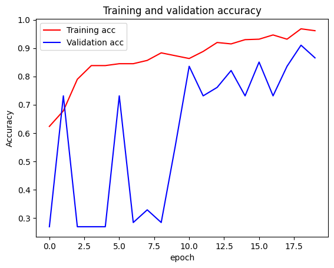

# Coal Mine Warning and Monitoring System

A safety system for underground coal mines that watches for the two biggest everyday dangers: **toxic or explosive gases** and **roof falls**. It has two parts:

1. **Gas monitoring (IoT):** an ESP32 with MQ gas sensors measures methane, CO, CO₂, NO₂ and H₂S, shows a green / yellow / red warning light, and streams the readings to a live cloud dashboard.
2. **Roof hazard detection (deep learning):** a MobileNet image classifier labels photos of the mine roof as *hazardous* or *non-hazardous*, reaching **84% accuracy** on held-out images.

## 1. Gas monitoring

### How it works

```
MQ-2 ──┐                    ┌─► Green / Yellow / Red LEDs (on site)
MQ-135 ┼─► ESP32 ─ Wi-Fi ───┤
MQ-136 ┘   (ppm estimates)  └─► Ubidots over MQTT (live dashboard, every 5 s)
```

| Sensor | Gases measured | ESP32 pin |
|---|---|---|
| MQ-2 | Methane (CH₄) | 34 |
| MQ-135 | Carbon monoxide (CO), carbon dioxide (CO₂), nitrogen dioxide (NO₂) | 12 |
| MQ-136 | Hydrogen sulfide (H₂S) | 33 |

The sketch converts each sensor's analog reading into an approximate concentration in ppm, publishes all five values to [Ubidots](https://ubidots.com/) every 5 seconds, and lights a warning LED:

| Light | Meaning | Condition (ppm) |
|---|---|---|
| 🟢 Green (pin 15) | Safe | CH₄ ≤ 800, CO ≤ 70, CO₂ ≤ 4000, NO₂ < 20 and H₂S < 20 |
| 🔴 Red (pin 5) | Danger | CH₄ ≥ 1200, CO₂ ≥ 5000, NO₂ > 50 or H₂S > 300 |
| 🟡 Yellow (pin 4) | Caution | Anything in between |

Thresholds are based on occupational exposure limits from OSHA and WHO.

### Hardware

- ESP32 development board
- MQ-2, MQ-135 and MQ-136 gas sensor modules
- Red, yellow and green LEDs with resistors

### Setup

1. Install the [Arduino IDE](https://www.arduino.cc/en/software) and add **ESP32** board support.
2. Install the libraries:
   - **MQUnifiedsensor** (Library Manager)
   - **Ubidots ESP32 MQTT** ([ubidots-esp32](https://github.com/ubidots/esp32-mqtt))
3. Create a free Ubidots account and copy your token.
4. In [`poisonous_gases.ino`](poisonous_gases.ino), fill in `UBIDOTS_TOKEN`, `WIFI_SSID` and `WIFI_PASS`.
5. Wire the sensors and LEDs to the pins above, then upload. Readings also print to the Serial Monitor at 115200 baud.

Readings appear in Ubidots under the device `esp32` as variables `CH4`, `CO`, `CO2`, `NO2` and `H2S`.

## 2. Roof hazard detection

Roof falls are one of the leading causes of injuries in underground mines. This part trains a model to spot dangerous roof conditions from photos, so inspections can flag risky areas automatically.

### Classifier — [`Compiled.ipynb`](Compiled.ipynb)

- **Model:** MobileNet (trained from scratch, 3.2M parameters) with two classes: *Hazardous* and *NonHazardous*
- **Input:** roof images resized to 224×224
- **Training:** SGD with momentum, 20 epochs, batch size 32, 67/33 train/test split
- **Result:** **83.9% test accuracy**
- The notebook also saves the model (`model.h5`) and runs it on a folder of new images, printing a label for each one

<p align="center">
  
</p>

### Data augmentation experiments

The dataset is small (about 800 images), so we also tried generating extra synthetic roof images:

- [`ACGAN_Test.ipynb`](ACGAN_Test.ipynb) — an Auxiliary Classifier GAN that generates images of a chosen class
- [`Modified_CVAE_pynb.ipynb`](Modified_CVAE_pynb.ipynb) — a convolutional variational autoencoder, adapted from the [TensorFlow CVAE tutorial](https://www.tensorflow.org/tutorials/generative/cvae) to the mine images

These are exploratory and didn't yet produce usable images.

### Running the notebooks

The notebooks are written for **Google Colab** and read images from Google Drive. The roof image dataset isn't included in this repo. To run them:

1. Put your images in Drive in two class folders:
   ```
   MyDrive/MineData/
   ├── images_haz/
   └── images_nonhaz/
   ```
2. Open a notebook in Colab (the badge at the top of each one), mount Drive, and run the cells.

## Repository contents

| File | What it is |
|---|---|
| `poisonous_gases.ino` | ESP32 sketch: gas sensing, warning LEDs, Ubidots upload |
| `Compiled.ipynb` | MobileNet roof hazard classifier: training, evaluation, prediction |
| `ACGAN_Test.ipynb` | AC-GAN experiment for synthetic roof images |
| `Modified_CVAE_pynb.ipynb` | Convolutional VAE experiment |
| `images/` | Figures for this README |

## Limitations

- Gas concentrations are **estimates** from uncalibrated, low-cost MQ sensors. This is a prototype, not certified safety equipment.
- The classifier was trained on a small dataset; more data and pretrained weights would likely improve accuracy.

## Contributors

[Abeera Alam](https://github.com/abeeraalam1) and [mr05498](https://github.com/mr05498).
